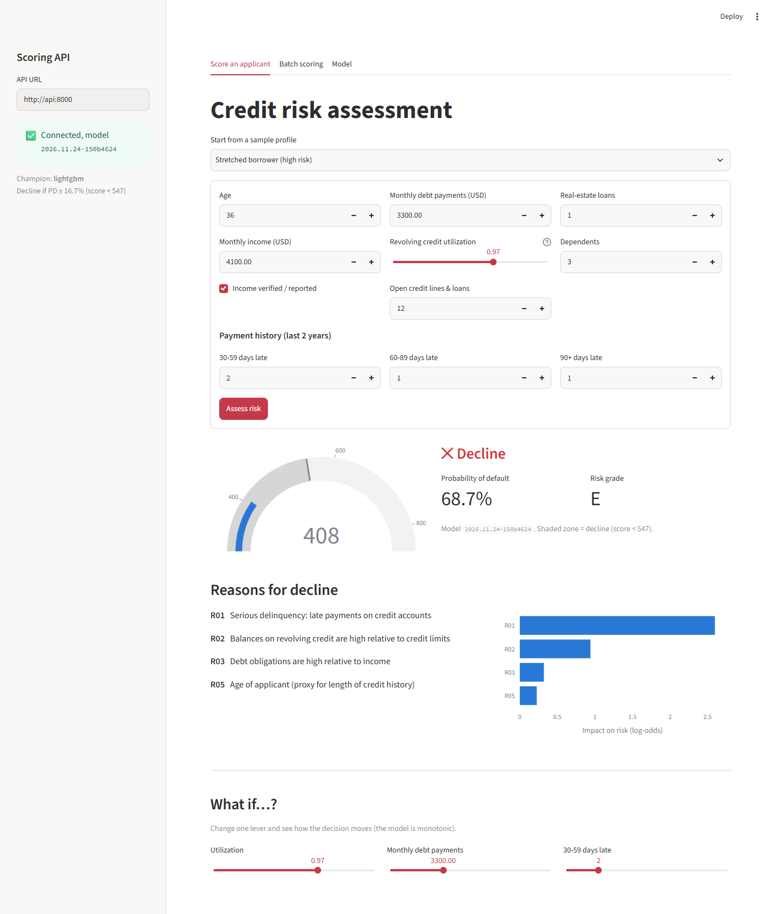
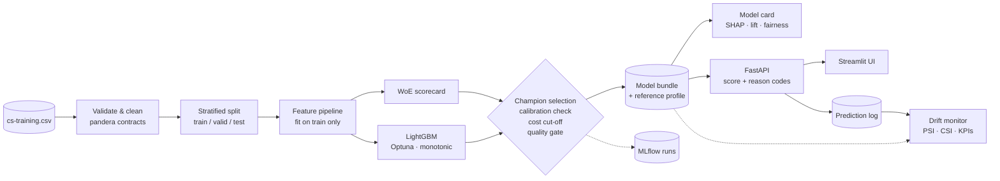

# Credit Risk Scoring System

[](https://github.com/Md-Faiz-Alam/Credit_scoring_model/actions/workflows/ci.yml)


An end-to-end consumer **probability-of-default (PD)** system, built the way a bank's
credit-risk team would build it. Data contracts, a regulator-friendly scorecard
against a gradient-boosting challenger, calibrated probabilities, a cost-based
approve/decline rule, per-applicant **reason codes**, an **age-fairness analysis**, a REST
API with a web UI, **drift monitoring**, Docker, and CI.



## Results (held-out test set, 22,409 applicants)

| Model | ROC-AUC | Gini | KS | Calibration error (ECE) |
|---|---|---|---|---|
| Original notebook (Random Forest + SMOTE) | 0.79 | 0.58 | n/a | uncalibrated |
| WoE logistic scorecard (challenger) | 0.856 | 0.711 | 0.568 | 0.0033 |
| **LightGBM, monotonic (champion)** | **0.865** | **0.730** | **0.589** | **0.0020** |

**Business impact** at the cost-optimal cut-off (decline if PD ≥ 16.7%, score < 547):
**89.6%** of applicants approved, with a bad rate of **3.2%** in the approved book (vs. 6.7% if
everyone were approved). The riskiest 10% of applicants hold 56% of all defaults.

Full methodology, charts, fairness tables and limitations: **[model card](docs/model_card.md)**.

## What the data revealed (and what the pipeline does about it)

Every modelling decision is traceable to evidence. These are the findings that mattered most:

1. **Hidden reporting codes, not counts.** The three late-payment columns contain `96`/`98` in
   the same 269 rows. Those rows default at **~55%**. They're kept as a flag, not treated as
   "98 late payments". The original notebook dropped two of these columns. One of them,
   `past_due_60_89`, turned out to carry **IV 0.58**.
2. **Data errors that look like risk.** Utilization above 10× (up to 50,708×) defaults at ~5%,
   like an ordinary customer, while genuine over-limit borrowers default at ~40%. Capping would
   have put errors into the riskiest group, so they become *missing + flag* instead.
3. **A column that changes meaning.** `DebtRatio` is a ratio when income is known (median 0.30),
   but a **dollar amount** when income is missing or zero (median ~1,200). It's split into two
   features. The API hides this quirk entirely: clients send debt payments and income.
4. **SMOTE and class weights hurt.** They left AUC unchanged but inflated the mean PD from 6.6%
   to 18%. Trained on the natural class balance, the model is calibrated as-is.
5. **A flat cost curve.** A grid search moved the cut-off between 15% and 19% across retrains
   for under 1% cost difference. The analytical rule cost_FP / (cost_FP + cost_FN) is stable
   and exact for calibrated PDs.
6. **Removing age makes things worse for older applicants.** Without age, the model
   **overstates risk for 61+ applicants by 1 pp (about a third too high)**, and declined good payers in that
   group rise from 2.7% to 3.8%. "Fairness through unawareness" shifts the harm onto the group
   the law protects. [Details](docs/model_card.md#fairness-age).
7. **PSI misses recessions.** In a simulated downturn, every PSI stayed below 0.1 while mean PD
   rose **41%**, because a uniform shift barely moves a binned distribution. The monitor
   also checks outcome KPIs, which caught it. [Example report](docs/monitoring/report.md).

## Architecture



* **One object from inputs to decision.** The feature pipeline, model, score scaling, grades,
  cut-off and lineage metadata are packaged together, so training and serving can't drift apart.
  A test asserts that the API returns exactly what the model returns offline.
* **The UI is just another API client.** Its Docker image contains no ML libraries.

## Scoring API

```bash
curl -X POST localhost:8000/predict -H "Content-Type: application/json" -d '{
  "age": 42, "monthly_income": 5400, "monthly_debt_payments": 1600,
  "revolving_utilization": 0.35, "open_credit_lines": 8, "real_estate_loans": 1,
  "dependents": 2, "past_due_30_59": 0, "past_due_60_89": 0, "past_due_90_plus": 0
}'
```
```json
{
  "probability_of_default": 0.025139,
  "score": 665,
  "risk_grade": "B",
  "decision": "approve",
  "reasons": [
    {"code": "R02", "message": "Balances on revolving credit are high relative to credit limits", "impact": 0.3248},
    {"code": "R05", "message": "Age of applicant (proxy for length of credit history)", "impact": 0.2614},
    {"code": "R04", "message": "Income is low, not reported, or low relative to household size", "impact": 0.0828}
  ],
  "model_version": "2026.11.25-c25329fd"
}
```
Also available: `POST /predict/batch` (up to 1,000), `GET /model-info` and `GET /health`.
Interactive docs are at `/docs`. Every request gets an `X-Request-ID` and is written to a
prediction log for monitoring.

## Quickstart

Requires Python 3.13 and [uv](https://docs.astral.sh/uv/).

```bash
git clone https://github.com/Md-Faiz-Alam/Credit_scoring_model.git
cd Credit_scoring_model
uv sync --all-extras
```

Get the data: download `cs-training.csv` from Kaggle's
[Give Me Some Credit](https://www.kaggle.com/c/GiveMeSomeCredit/data) into `data/raw/`, or
run `uv sync --extra data && uv run poe download` with a Kaggle API token.

| Step | Command | Output |
|---|---|---|
| Validate, clean, split | `uv run poe data` | `data/processed/*.parquet`, `reports/data_quality.json` |
| Feature analysis | `uv run poe features` | IV / WoE tables in `reports/` |
| Train (~5 min) | `uv run poe train` | `models/credit_model.joblib`, MLflow run |
| Evaluate | `uv run poe evaluate` | `docs/model_card.md` + charts |
| Serve | `uv run poe api` and `uv run poe ui` | API :8000, UI :8501 |
| Monitor | `uv run poe simulate --scenario downturn`<br/>`uv run poe monitor --log logs/simulated_downturn.jsonl` | drift report |
| Quality checks | `uv run poe check` | lint, format, types, tests + coverage |

**Docker** (after `poe train`; the model is mounted, not baked into the image):

```bash
docker compose up --build        # UI http://localhost:8501 · API http://localhost:8000/docs
```
If those ports are taken, set `API_PORT` / `UI_PORT`. Try a deep link: `http://localhost:8501/?profile=high-risk`.

**Cloud (Render, free plan):** two Docker web services built from this repository.
* **API:** `docker/api.Dockerfile`, health check `/health`. Set `WEB_CONCURRENCY=1`,
  `CREDIT_MODEL_URL` and `CREDIT_MODEL_SHA256`.
* **UI:** `docker/ui.Dockerfile`, health check `/_stcore/health`. Set `CREDIT_API_URL` and
  `CREDIT_API_TIMEOUT=120`.

The model is published as a GitHub Release asset. At startup the API downloads it and refuses to
load it unless its SHA-256 matches `CREDIT_MODEL_SHA256`, because unpickling an unverified file
would run arbitrary code.

## Engineering

* **Tests:** 135 tests on synthetic data with planted problems, 96% coverage, 90% gate in CI.
  They cover leakage (cleaning and features are row-independent), WoE monotonicity, SHAP
  additivity, the quality gate rejecting a useless model, API contracts, and the Streamlit
  app driven headlessly.
* **CI (GitHub Actions):** ruff lint and format, strict mypy, tests with the coverage gate, then
  both Docker images are built and smoke-tested.
* **Reproducibility:** `uv.lock` pins every dependency. `configs/train.yaml` holds every
  modelling choice, validated by pydantic. Each model records the input data's SHA-256 and
  the git commit it was trained from.
* **Containers:** multi-stage builds, non-root, health checks, a read-only API filesystem, and a
  UI image with no ML stack.

## Project structure

```
configs/train.yaml          every modelling choice (validated)
src/credit_scoring/
  data/                     download, contracts (pandera), cleaning, split, lineage
  features/                 domain transformer, WoE binning + IV
  models/                   scorecard, LightGBM, calibration, cut-off, scoring, training
  evaluation/               metrics, lift, fairness, charts, model card
  explain/                  SHAP reason codes
  api/                      FastAPI service, schemas, prediction log
  monitoring/               PSI/CSI, reference profile, traffic simulator, drift report
  ui/                       HTTP client for the UI
app/streamlit_app.py        web UI
notebooks/01_eda.ipynb      exploratory analysis
docker/, docker-compose.yml containers
docs/                       model card, monitoring report, figures
tests/                      135 tests
```

## Limitations

* **No out-of-time validation:** the dataset has no application dates, so the test split is random.
* **One population:** US consumer credit from around 2008. Recalibrate before using it on another market.
* **Assumed costs:** the 5:1 cost ratio is an assumption, and the cut-off should come from real
  loss-given-default and margin figures.
* **Proxy features:** features such as income could act as proxies for protected attributes
  that aren't in the data.
* **No API security layer:** there's no authentication or rate limiting. In production the
  API would sit behind a gateway that handles both.

## License

[MIT](LICENSE)
