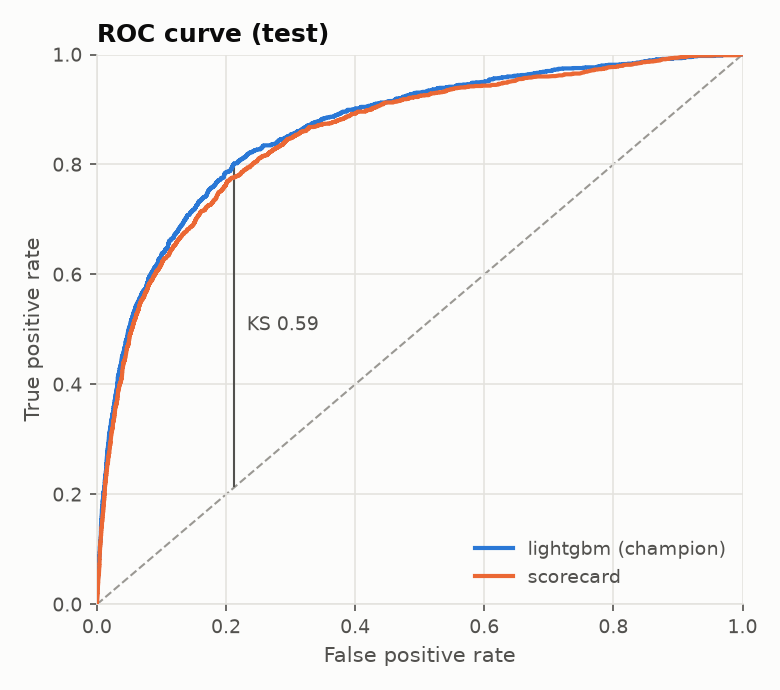
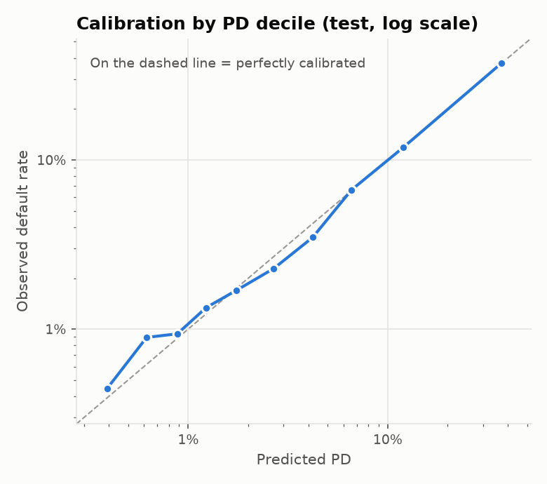
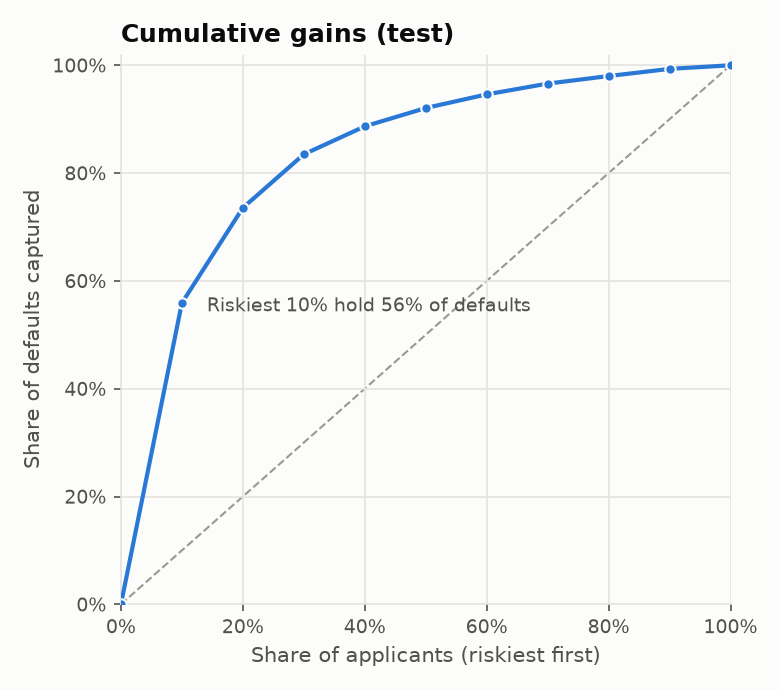
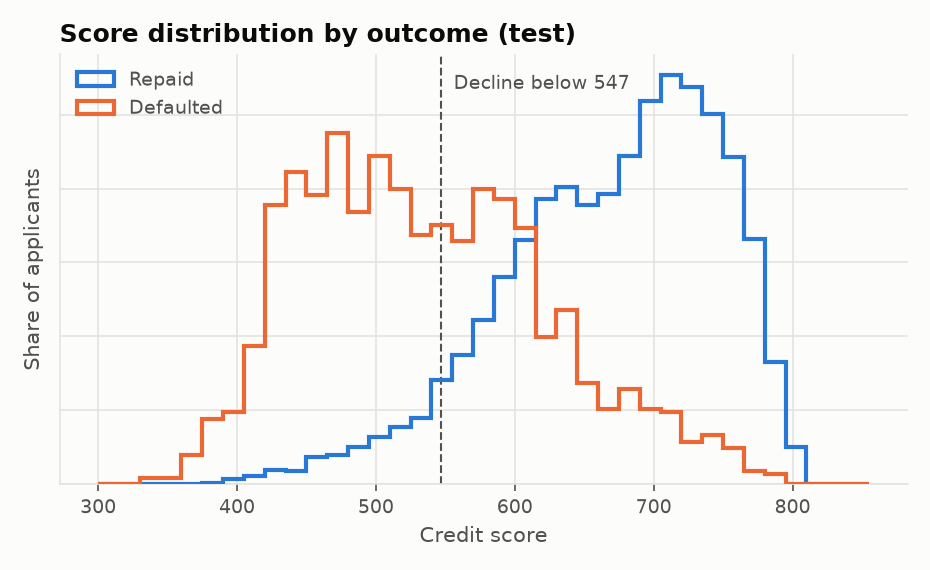
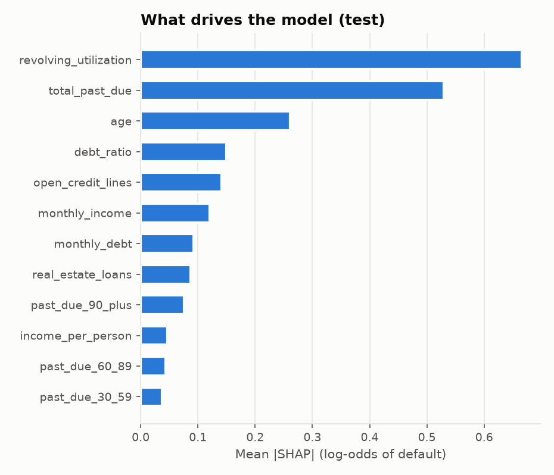
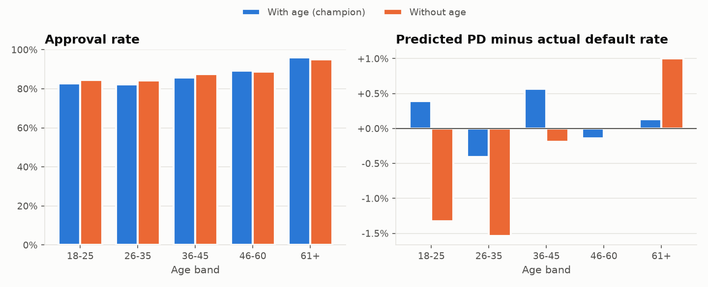

# Model Card: Credit Default Risk (PD) Model

> Generated by `uv run poe evaluate` from the trained model. Don't edit by hand.

| | |
|---|---|
| Model version | `2026.11.25-c25329fd` |
| Champion | **lightgbm** (challenger: WoE logistic scorecard) |
| Trained | 2026-11-25T03:21:53+00:00 (git `860f80e`) |
| Training data | `cs-training.csv`, sha256 `01a89f8446f3504c...` |
| Split (stratified) | train 104,573 / valid 22,409 / test 22,409 |

## Intended use

Estimates the **probability that an applicant becomes 90+ days delinquent within two
years** (PD), for consumer credit decisioning. It returns the PD, a 300-850 score, a risk
grade (A-E), an approve/decline decision and up to four reason codes.

**Not intended for:** loan pricing without recalibrating to the target portfolio,
populations unlike the training data (see Limitations), or fully automated decisions
without a human review route for declined applicants.

## Performance (held-out test split)

| model | auc | gini | ks | pr_auc | brier | ece |
|---|---|---|---|---|---|---|
| lightgbm (champion) | 0.865 | 0.730 | 0.589 | 0.405 | 0.0488 | 0.0020 |
| WoE logistic scorecard | 0.856 | 0.711 | 0.568 | 0.372 | 0.0501 | 0.0033 |

The champion is the challenger LightGBM only if it beats the interpretable scorecard by
at least 0.005 AUC on validation. Selection, calibration and threshold
choices used the validation split. These test numbers were computed once.

| ROC | Calibration |
|---|---|
|  |  |

Calibration: mean predicted PD 6.76% vs observed default rate
6.70%, expected calibration error 0.0020.
No class reweighting or oversampling was used, because they inflate PDs without improving ranking.

## Business impact

Decision rule: **decline if PD >= 16.7%** (score below 547). The
cut-off minimises expected cost, assuming that approving a borrower who defaults costs
5x as much as declining one who would have repaid:
cut-off = cost_FP / (cost_FP + cost_FN).

| Metric (test) | Value |
|---|---|
| Approval rate | 89.6% |
| Bad rate of approved book | **3.2%** (vs 6.7% if everyone were approved) |
| Defaults declined | 56.8% |
| Good payers declined | 7.1% |
| Riskiest 10% of applicants | contain 55.9% of all defaults |

| Gains | Score distribution |
|---|---|
|  |  |

<details><summary>Strategy table: approval rate vs bad rate</summary>

| approval_rate | pd_cutoff | bad_rate_approved | defaults_caught | expected_cost |
|---|---|---|---|---|
| 50.0% | 0.021 | 1.06% | 92.1% | 0.465 |
| 55.0% | 0.026 | 1.16% | 90.5% | 0.421 |
| 60.0% | 0.034 | 1.26% | 88.7% | 0.379 |
| 65.0% | 0.042 | 1.43% | 86.1% | 0.339 |
| 70.0% | 0.052 | 1.58% | 83.5% | 0.299 |
| 75.0% | 0.065 | 1.80% | 79.8% | 0.264 |
| 80.0% | 0.084 | 2.21% | 73.6% | 0.239 |
| 85.0% | 0.115 | 2.67% | 66.2% | 0.219 |
| 90.0% | 0.173 | 3.28% | 55.9% | 0.210 |
| 95.0% | 0.332 | 4.46% | 36.8% | 0.237 |
| 100.0% | nan | 6.70% | 0.0% | 0.335 |

</details>

## Explainability

Each prediction comes with SHAP contributions (exact TreeSHAP), which are grouped into stable,
customer-facing **reason codes**. Several features that describe one fact (e.g. four
late-payment columns) form one reason.



Example declined applicants (test split):

1. Score **537**, PD 19.1% -> decline
   - `R02` Balances on revolving credit are high relative to credit limits
   - `R03` Debt obligations are high relative to income
   - `R06` Number of open credit lines and loans
   - `R04` Income is low, not reported, or low relative to household size
2. Score **507**, PD 28.3% -> decline
   - `R01` Serious delinquency: late payments on credit accounts
   - `R02` Balances on revolving credit are high relative to credit limits
   - `R08` Number of dependents
   - `R04` Income is low, not reported, or low relative to household size
3. Score **505**, PD 29.3% -> decline
   - `R03` Debt obligations are high relative to income
   - `R07` Number of real-estate loans or lines
   - `R01` Serious delinquency: late payments on credit accounts
   - `R06` Number of open credit lines and loans

## Fairness: age

Age is a protected characteristic. Per age band on the test split:

**Champion (uses age)**

| group | count | default_rate | mean_pd | auc | approval_rate | adverse_impact_ratio | goods_declined |
|---|---|---|---|---|---|---|---|
| 18-25 | 449 | 11.6% | 12.0% | 0.858 | 82.6% | 0.86 | 10.6% |
| 26-35 | 2,783 | 11.2% | 10.8% | 0.836 | 82.4% | 0.86 | 11.9% |
| 36-45 | 4,525 | 8.3% | 8.9% | 0.855 | 85.8% | 0.89 | 10.2% |
| 46-60 | 8,018 | 7.1% | 6.9% | 0.854 | 89.1% | 0.93 | 7.4% |
| 61+ | 6,634 | 2.9% | 3.0% | 0.856 | 96.2% | 1.00 | 2.7% |

**Same model refit without age** (AUC 0.8620 vs 0.8649)

| group | count | default_rate | mean_pd | auc | approval_rate | adverse_impact_ratio | goods_declined |
|---|---|---|---|---|---|---|---|
| 18-25 | 449 | 11.6% | 10.2% | 0.853 | 84.4% | 0.89 | 8.8% |
| 26-35 | 2,783 | 11.2% | 9.7% | 0.833 | 84.2% | 0.89 | 10.1% |
| 36-45 | 4,525 | 8.3% | 8.1% | 0.853 | 87.4% | 0.92 | 8.8% |
| 46-60 | 8,018 | 7.1% | 7.1% | 0.855 | 88.9% | 0.94 | 7.7% |
| 61+ | 6,634 | 2.9% | 3.9% | 0.856 | 95.0% | 1.00 | 3.8% |



**Finding**

* With age, predicted PD tracks the actual default rate in every band (largest gap 0.6 pp). Approval-rate differences follow real differences in default rates (11.6% for 18-25 vs 2.9% for 61+). Lowest adverse impact ratio: 0.86 (passes the four-fifths rule).
* Removing age raises the lowest adverse impact ratio to 0.89, but the model loses calibration by group. It understates risk for 18-25 by 1.3 pp and **overstates it for 61+ by +1.0 pp**. Good payers aged 61+ who are declined rise from 2.7% to 3.8%.
* "Fairness through unawareness" therefore shifts the cost onto older applicants, the group that age-discrimination rules protect most explicitly. The champion **keeps age**. It's monotonically constrained so that, all else equal, greater age never increases risk, and the decision should be reviewed with compliance.

## Limitations

* **No out-of-time validation.** The dataset has no application dates, so the test split
  is random rather than later in time. Real deployment needs an out-of-time holdout and
  population-stability monitoring.
* **Population.** Kaggle "Give Me Some Credit" (US consumer credit, ~2008 era). Base
  rates and relationships will differ for other markets and periods. Recalibrate before use.
* **Cost assumptions.** The 5:1 cost ratio is an assumption. The cut-off should be set
  from the lender's actual loss-given-default and margin.
* **Data quality.** Self-reported income (about 20% missing) and utilization values far above
  100% are treated as described in `src/credit_scoring/features/transformers.py`.
* **Proxy risk.** Features other than age (e.g. income, dependents) may correlate with
  protected characteristics that aren't in the data and can't be tested here.

## Reproduce

```bash
uv run poe data       # validate, clean, split
uv run poe train      # train, compare, calibrate, package
uv run poe evaluate   # this card
```
