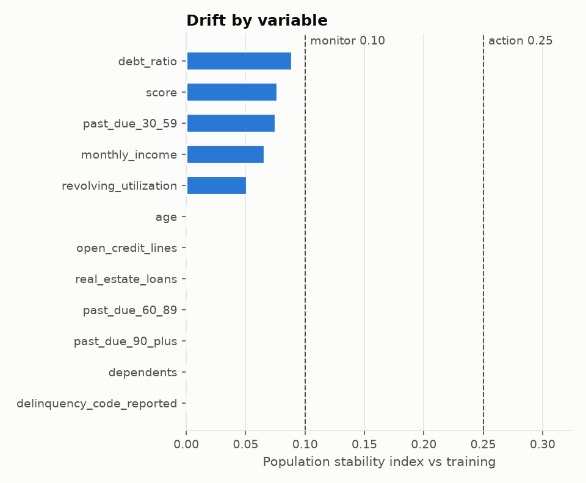
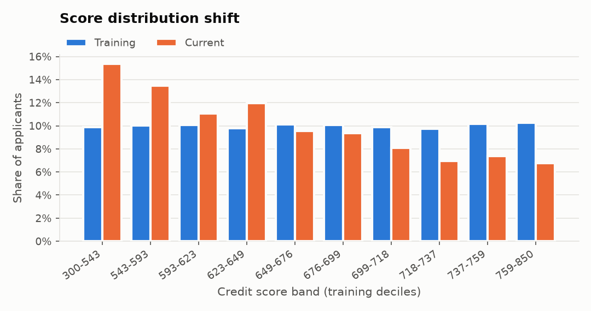

# Drift monitoring report

**Overall status: 🔴 ACTION**

| | |
|---|---|
| Generated | 2026-11-25T01:57:45+00:00 |
| Prediction log | `simulated_downturn.jsonl` (4,992 scored applications) |
| Window | 2026-11-25T01:56:51+00:00 to 2026-11-25T01:56:54+00:00 |
| Reference | training population, model `2026.11.24-150b4624` |
| Approval rate | 89.6% (training) -> **83.5%** (current) 🔴 ACTION |
| Mean PD | 6.69% (training) -> **9.42%** (current) 🔴 ACTION |

## Alerts

* Mean PD 6.69% -> 9.42% (+41%, action): portfolio risk has moved
* Approval rate 89.6% -> 83.5% (action)

## Stability by variable

PSI < 0.1 stable · 0.1-0.25 monitor · > 0.25 action.

| variable | PSI | status | missing rate | mean |
|---|---|---|---|---|
| score | 0.077 | 🟢 STABLE | 0.0% -> 0.0% | 661 -> 637 |
| debt_ratio | 0.089 | 🟢 STABLE | 0.0% -> 0.0% | 353 -> 375 |
| past_due_30_59 | 0.076 | 🟢 STABLE | 0.2% -> 0.1% | 0.246 -> 0.384 |
| monthly_income | 0.066 | 🟢 STABLE | 19.6% -> 19.1% | 6.64e+03 -> 6e+03 |
| revolving_utilization | 0.051 | 🟢 STABLE | 0.0% -> 0.0% | 6.57 -> 0.398 |
| age | 0.001 | 🟢 STABLE | 0.0% -> 0.0% | 52.3 -> 52.4 |
| open_credit_lines | 0.001 | 🟢 STABLE | 0.0% -> 0.0% | 8.49 -> 8.55 |
| real_estate_loans | 0.000 | 🟢 STABLE | 0.0% -> 0.0% | 1.02 -> 1.04 |
| past_due_90_plus | 0.000 | 🟢 STABLE | 0.2% -> 0.1% | 0.0918 -> 0.0927 |
| past_due_60_89 | 0.000 | 🟢 STABLE | 0.2% -> 0.1% | 0.0645 -> 0.0622 |
| dependents | 0.000 | 🟢 STABLE | 2.6% -> 2.6% | 0.759 -> 0.761 |
| delinquency_code_reported | 0.000 | 🟢 STABLE | 0.0% -> 0.0% | 0.0015 -> 0.0012 |

| | |
|---|---|
|  |  |

KPI limits: approval rate change ≥ 3% monitor / ≥ 5% action (absolute);
mean PD change ≥ 15% monitor / ≥ 30% action (relative).

## How to read this

* **Score PSI** says *whether* the applicant risk mix moved. **Feature CSI** says *why*.
* **KPIs** catch what PSI misses. A uniform shift across all score bands (a recession)
  can keep every PSI low while mean PD and approvals move sharply.
* Drift isn't automatically a model problem. If the inputs moved but the model's
  relationships still hold, PDs stay calibrated. Confirm with realised defaults when
  labels mature, before retraining.
* A jump in a **missing rate** usually means an upstream data issue, not a real
  population change. Fix the feed before touching the model.
